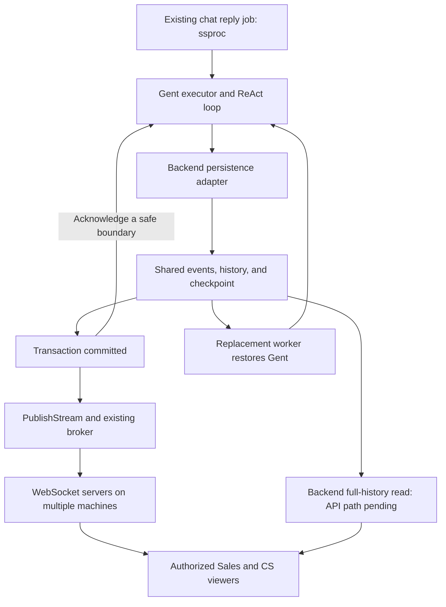

# Gent requirements: execution history, compaction, and checkpoint recovery

## Handoff context

This document is for a separate agent session working on the Gent library. The requester owns Gent and wants the
library to support durable, shared observation and recovery of agent execution. Read the current Gent source and its
repository instructions before making changes. Implement the library contracts, tests, examples, and documentation
needed for the requirements below. Application database tables, chat services, WebSocket routes, and UI changes belong
to the consuming application and are outside this library task.

The source reviewed for this discussion was `github.com/rickchristie/gent v0.1.2`, commit
`27af6672a4be8516c266498068c340a43f015090`. The backend uses that published version. Its local source
copy is `.tmp/gent`. Source references are relative to the **Gent repository root**, except references with a `backend:`
prefix, which are relative to the consuming backend repository. Backend references explain existing integration points;
the Gent implementor does not need that repository to understand or implement these library requirements.
Check the version in the next session; do not assume line numbers or behavior remain unchanged.

This is a requirements handoff, not a final API specification. Required behavior and the removal of the text `Diff`
field are agreed. Suggested type names and event layouts are design proposals. Choose and document the concrete
interfaces after checking the implementation, while preserving the required behavior. Do not update the backend's
`plan-gent-implementation.md` as part of the Gent library task; the backend session maintains that application plan.

## Product requirements already agreed

1. **One shared history for all authorized viewers.** Different CS and Sales staff, on different computers and accounts,
   can open the same chat and see the same response generation. A person who arrives during iteration 5 must be able to
   load earlier activity and then receive new activity without gaps. A person who arrives after completion must still
   be able to inspect the entire generation.
2. **Permanent evidence for improvement.** Preserve model input/output, emitted thinking, tool arguments/results,
   compactions and their summaries, errors, and the final response. For a policy lookup, preserve the actual returned
   text and identifiers so a later policy edit cannot change the evidence explaining an earlier answer.
3. **Recovery after interruption.** Application workers can restart, crash, lose their lease, or be replaced during a
   release. Completed, checkpointed work and its history must remain usable by another worker. An in-progress model
   request may need to restart; recorded partial activity must remain visible as an interrupted attempt.
4. **No machine or viewer owns the record.** A browser subscription, local stream buffer, or worker's memory cannot be
   the only place that holds execution history. The application will persist the library's state in shared storage.
5. **Remove the text `Diff` field entirely.** The requester has explicitly rejected a text diff between JSON documents.
   Do not retain it as a deprecated, optional, or lazily computed field in the updated event contract. Keep the
   state-change events and their event numbering; only the text diff and its computation are to be removed.

The backend already has a generic WebSocket stream transport and a durable job system, `ssproc`. WebSocket broker
delivery can lose or reorder updates and does not provide replay. The library must expose ordered, serializable state
and changes that the application can persist and replay independently of live delivery. Gent must remain independent
of this backend, its database, its WebSocket implementation, and `ssproc`.

## Planned use in the Rukita backend

### First application and existing components

The goal is to use Gent as the main library for AI execution. The backend already uses Gent's embedded-model search
for policy lookup. Its chat assistants still use the existing assistant implementations; a Gent chat executor has not
yet been integrated. This library work must let us add that executor with durable observation and continuation.

The backend will adopt these contracts by upgrading its published Gent module dependency. The `.tmp/gent` source copy
is for review; it does not replace the published module used by backend builds.

The proposed first release uses two internal assistants on the existing `ASSISTANT_UAT` chat channel type. The proposed
labels are `EXPERIMENT_SALES_GENT` and `EXPERIMENT_CS_GENT`. Proposed assistant IDs are `SalesAssistantGent` and
`CsAssistantGent`.
These names describe the intended experiments; they are not implemented or required Gent types. An authorized admin
can create a UAT channel, assign an assistant, and send an impersonated tenant or landlord message for testing. The
shared generation trail is for authorized staff viewing that chat. Gent does not decide chat access or impersonation.

We plan to keep `AssistantReplyProcess` and `ssproc` as the outer process for reply generation and delivery. A Gent
executor and ReAct loop will run inside the generation step. Each run has separate mutable execution and trace objects.
Today that step saves the generated reply, memory, cost, and debug data after generation returns. We need Gent to expose
state during generation so the backend can also save progress and checkpoints before the final reply exists.

| Component we plan to use | Responsibility and required change |
| --- | --- |
| Gent executor and ReAct loop | Run models and tools; expose complete history, compactions, and consistent continuation boundaries. |
| Gent `CommonDiffEvent` mechanism | Keep publishing state changes. Supply structured history/checkpoint changes; remove only the text `Diff` and its computation. |
| Gent `trace.Sequencer` and trace subscriptions | Keep run identity, event numbers, model/tool correlation, and live progress. Integrate durable acknowledgment and restoration without losing this event stream. |
| Backend persistence adapter and shared database | Save numbered events, history changes, and checkpoint state. Own transactions, duplicate detection, and rejection of writes from an old worker. |
| Backend `websocket.Publisher.PublishStream` and existing broker | Send committed events to the chat's authorized viewers through WebSocket servers on any machine. |
| Backend read APIs and UI | Load full saved generation history, expand iterations and compactions, and reload full history to recover live updates by run ID and event number. New API paths are pending. |
| Backend `ssproc` | Assign/retry work and manage worker leases. Use Gent continuation when another worker takes over an interrupted generation. |

The current `trace.Sequencer.Snapshot()`, `EventsAfter()`, and `SubscribeWithConfig()` methods are useful groundwork.
Their process-local buffers do not provide shared storage or execution recovery. Keep their observation capabilities
and connect the new durable contract to the same numbered trace. Do not require the backend to construct a separate,
unrelated numbering system for history changes.

### Producer, storage, and viewer flow



The intended use is:

1. **Start or resume a generation.** The backend associates a Gent run ID with the chat, input messages, and reply job.
   A channel can have many generation runs; the channel ID alone cannot identify their events. A worker change must
   preserve the identity of the generation being continued.
2. **Record throughout execution.** The backend consumes numbered model, tool, history, compaction, and outcome events
   even when no browser is connected. Gent's durable contract must connect these events to the state they describe.
   Model chunks and tool starts remain visible during an iteration; we do not wait for iteration completion to record
   all activity. Only emitted model content can be recorded; undisclosed provider reasoning is outside this contract.
3. **Commit related data together.** For a change at a resumable boundary, one backend transaction appends the numbered
   event or batch, saves its new history entries/transitions, and saves the matching checkpoint and history revision.
   A progress-only event is saved without advancing the resumable checkpoint. A full serialized history is acceptable
   as a first storage format; incremental entries are also acceptable if they reconstruct exactly the same history.
   This is a logical consistency requirement, not a requirement for a particular database schema or one write per token.
4. **Publish after commit.** The backend passes the committed numbered events to `PublishStream`, in batches where
   useful. The existing broker delivers them across machines. A browser disconnect or a failed broadcast must not
   remove the saved record. If a worker crashes between commit and broadcast, a full-history reload includes the saved
   activity.
5. **Load history and join live updates.** Subscribe first and buffer incoming numbered changes. Load full history with
   its `lastAppliedEventNumber`, discard buffered events at or below that number, and apply consecutive later events.
   Reuse the full-history read for recovery, including gaps, reconnects, and a lost final event. Saved progress after
   the last checkpoint must be included. The detailed frontend flow below is agreed; new API paths are pending.
6. **Continue after interruption.** A replacement worker loads the last accepted checkpoint, its history, and the
   highest saved event number. It supplies compatible models/tools/configuration and uses Gent's continuation API.
   It retains committed partial activity, identifies interrupted attempts, and starts new numbering after all saved
   events. The backend owns lease checks and rejection of stale writes; Gent must surface a rejected save and stop.
7. **Finish and retain the evidence.** The final result and outcome remain inspectable after completion and after all
   workers have exited. The outer chat process handles message delivery and its retry rules. Restoring a finished Gent
   run returns its saved result instead of generating another answer.

The suggested WebSocket resource is the owning chat channel, with each payload identifying its run. The exact feature
stream name, resource contract, database tables, and read API shapes remain backend design choices. This library task
must supply the portable state and event contracts needed by that flow, without implementing those backend components.

### Agreed frontend flow and pending API paths

The frontend uses full-history reads for both initial loading and recovery. A dedicated missing-events API is not
required. Keep the persisted numbered events and Gent's structured change/trace contracts; this is a choice about the
backend's read API, not a removal of the event stream or its numbering.

The existing generic stream token and WebSocket subscription calls remain in use. The new backend API paths for
finding runs in a chat and reading a run's full history are **pending**. Do not select or implement HTTP paths in the
Gent library session. The run lookup must allow selection of current and previous generations with pagination.

For human A opening the chat during iteration 5:

1. **Subscribe and buffer.** Install the incoming-event handler before sending `streamSubscribe`. Buffer changes by
   run ID and event number. Wait for `serverStreamSubscribed` before starting the full-history load.
2. **Read full history.** Select the run and load its saved history, committed partial activity, status, and
   `lastAppliedEventNumber = N`. Continue buffering throughout the read. The content and cursor must describe one
   consistent committed state; N cannot cover events whose effects are absent from that state.
3. **Trim and apply.** Replace the view with the returned history. Discard buffered events at or below N. Apply only
   N + 1, advance the applied cursor after its changes apply, and repeat while consecutive events are available.
   Retain later events while waiting for a missing predecessor. Keep separate applied cursors for different runs.
4. **Continue live.** Buffer new changes and use the same rule. Ignore duplicates and retain the individual numbers
   within a transport batch. The applied cursor must never advance past a gap.
5. **Reload on recovery.** If a gap remains, repeat the same full-history read while buffering. After a disconnect or
   expired subscription, restore the subscription before reloading. Replace the view only after a successful load,
   discard events covered by its cursor, and continue with the next event number.
6. **Find a lost final event.** Occasionally reload full history while the displayed run is unfinished. A dropped
   completion notification can leave no later event to expose a gap. The frontend also sends pings and renews stream
   grants. Refresh timing, gap wait, buffer limits, and retry settings remain backend/frontend implementation details.

Use one full-history load per run at a time. A failed load does not advance the cursor or clear the buffer. A buffer
overflow requires a full-history reload before normal event application resumes. Reject an older response rather than
moving an already applied cursor backward.

For example, after a load through event 128, event 129 can be committed but its notification lost. Event 130 then waits
in the buffer. A full-history reload through 130 incorporates both changes, clears covered buffer entries, and lets
the frontend continue at 131. There is no separate missing-event request in this flow.

The full-history response must include saved progress covered by its event cursor, even if the execution checkpoint
ends after iteration 4 and iteration 5 is still running. A trace's latest event number cannot be attached to a history
array that omits the corresponding partial activity. Gent must expose enough consistent state and correlation for
the backend to construct this response from shared storage without contacting the original worker.

The backend and frontend own these API calls, buffers, timers, and authorization. Gent owns the complete serializable
state and numbered changes used to construct the view. Full-history reload cost is accepted for this first design.

### Example: join during iteration 5, then recover on another machine

The numbers below are illustrative and identify events, not execution iterations or history revisions.

| Point in time | Saved state and expected behavior |
| --- | --- |
| Worker A completes iteration 4 | History and a resumable checkpoint are committed with events through number 120. |
| Worker A starts iteration 5 | Model/tool progress events 121 through 128 are committed. The resumable checkpoint still ends after iteration 4. |
| Sales A opens the chat on another server | Sales A subscribes and buffers first. The full-history read returns earlier history and committed progress through event 128. Covered buffer entries are discarded, then consecutive events from 129 are applied. Sales A sees the same activity as CS B, who has watched from the start. |
| Worker A crashes before iteration 5 completes | All committed events through 128 remain available. The partial attempt must not appear as a completed iteration. |
| Worker B takes over | It restores the checkpoint after iteration 4, retains events 121 through 128, and records recovery/new attempt activity starting at event 129. It does not repeat checkpointed iterations 1 through 4. |
| A viewer opens the chat after completion | Shared storage provides the full generation, including the interrupted attempt, retry, tool results, compaction summaries, and final answer. No original worker is needed. |

If a tool's external action completed before the crash but its result was not committed, the backend/tool adapter must
reconcile that action or use its idempotency contract before retrying it. Event numbering and checkpoints alone cannot
resolve that uncertainty. Likewise, partial model output is evidence of an interrupted request, not a resumable provider
request unless the provider explicitly supports that operation.

For diagnosis, a viewer must be able to inspect the policy query, exact returned policy text, and actual model request.
They must also be able to expand each compaction's inputs and summary. This lets us distinguish a wrong policy lookup
from an unclear policy or a fact lost in a later summary. The final answer and a trace summary alone are insufficient.

### Backend source references

These references identify existing components, not completed Gent integration:

| Existing component | Backend source |
| --- | --- |
| Embedded-model policy search | `backend:service/policy/policysearch/cache.go:16` |
| Current assistant registration | `backend:service/aide/exec/assistants.go:33` |
| UAT creation and assistant assignment routes | `backend:pservice/admin/chat/routes.go:64`, `backend:pservice/admin/chat/routes.go:76` |
| Impersonated messages and tenant/landlord model roles | `backend:service/chat/service.go:1935`, `backend:service/chat/process_assistant_reply.go:256` |
| Reply subprocesses and save after generation | `backend:service/chat/process_assistant_reply.go:125`, `backend:service/chat/process_assistant_reply.go:350` |
| Worker retries and overlapping-worker constraints | `backend:service/lib/ssproc/process.go:80` |
| Stream producer | `backend:lib/websocket/gobwas_pubsub_client.go:133` |
| Feature authorization and stream grant configuration | `backend:pservice/ws/stream/granter.go:118` |
| Feature streams are not yet registered in either entry point | `backend:pservice/entry/main/main.go:718`, `backend:pservice/entry/wstenant/main.go:1279` |

## Current behavior and gaps to verify

| Area | Behavior observed in v0.1.2 | Source |
| --- | --- | --- |
| Iteration records | `Iteration` stores messages, origin, expiry, and metadata. One execution iteration can create multiple records. | `agent.go:304`, `agents/react/agent.go:253` |
| History | `BasicLoopData` appends records to `iterationHistory`. | `agent.go:185` |
| Scratchpad | A separate array supplies working context to the next model request. | `agent.go:206`, `agents/react/agent.go:638` |
| Sliding window | Replaces the scratchpad with selected recent/pinned records; history remains unchanged. | `compaction/sliding_window.go:34` |
| Summarization | Creates a synthetic summary only in the scratchpad. The summary is not added to history. | `compaction/summarization.go:775` |
| Changes | `CommonDiffEvent` contains `Before`, `After`, and an eagerly computed unified text diff of pretty-printed JSON. | `events.go:455`, `context.go:1433` |
| Event order | Tool iteration: tools finish, history changes, scratchpad changes, then `AfterIteration`. Final answers can update history without updating scratchpad. | `agents/react/agent.go:253`, `executor/executor.go:154` |
| Snapshot stability | Arrays copy their slices but can share mutable record pointers. In-place scratchpad mutations can change history. | `agent.go:188`, `agent.go:209` |
| Restoration | Saved scratchpad records can be supplied to a new execution, but a new context starts with fresh counters and identity. No complete checkpoint restoration API was found. | `context.go:153`, `context.go:543` |
| JSON restoration | Plain `json.Unmarshal` into `[]*Iteration` fails on interface-valued message parts. Tool metadata also requires concrete types to be restored. | `agent.go:412`, `agents/scratchpad.go:240` |
| Compaction state | Counter-based compaction triggers keep the last-compaction counter values outside the iteration arrays. | `compaction/stat_threshold_trigger.go:56` |
| Trace | `trace.Sequencer` provides event numbering, live subscriptions, snapshots, and bounded in-memory replay. These are not a durable execution checkpoint. | `trace/sequencer.go:51`, `trace/subscription.go:39` |

Temporary tests confirmed the two compaction behaviors, the shared-pointer issue, change-event order, JSON decoding
failure, and use of a pre-populated scratchpad. These tests are evidence, not a permanent implementation to depend on.
The next session must add permanent regression tests to Gent for the new contracts.

## Required history model

### Preserve originals and every compaction

History must be an ordered, append-only record of execution. Each entry needs a stable identity, an ordering value,
a kind, and enough correlation information to identify its run, execution iteration, context, and relevant model/tool
call. Exact field names and whether some information lives in an enclosing record are design choices.

An entry can represent an ordinary iteration, a compaction, a context injection/change, or other execution activity.
Do not assume that every history entry is one executor iteration. `HistoryEntry` is a suggested name; extending the
existing type is acceptable if the distinction remains clear and type-safe.

Compaction must, by default:

- Preserve original entries and prior summaries in history.
- Append a record of the compaction and its generated summary, when the strategy generates one.
- Identify the inputs used, including a previous summary when progressive summarization uses it.
- Record the resulting active context in its exact order, including pinned and retained recent entries.
- Record removal-only compactions as well, including sliding-window operations that produce no summary.
- Preserve a failed compaction attempt and its error without treating its proposed result as accepted context.

For example, after two compactions:

```text
History: [I1, I2, I3, I4, I5, C1, I6, C2, I7, I8]

C1:
  inputs: [I1, I2, I3]
  summary: <complete first summary>
  active context afterward: [C1, I4, I5]

C2:
  inputs: [C1, I4, I5]
  summary: <complete second summary>
  active context afterward: [C2, I6]

After I8, assuming I7 and I8 both continue the loop:
  active context: [C2, I6, I7, I8]
```

This example treats a compaction entry as the source of its summary content. A design that gives the summary a separate
history ID is also acceptable if the relationship is explicit. The UI must be able to expand the second compaction,
inspect its input and output, and locate information omitted by that summary without access to the original worker.

### Derive scratchpad from history

The scratchpad must be reproducible from saved history at a selected revision. It may be cached in memory for efficient
execution, but it must not hold unique content or unexplained state changes that are absent from history.

The suggested representation is an ordered list of active history-entry references. Record the effect of every change
to working context: normal additions, compaction, pinning, injection, replacement, reordering, and expiry.
A full ordered list of active references after a change is acceptable and simpler than inferring removal and insertion
rules.

An implementation may instead use explicit structured operations if replay remains deterministic and covers custom
strategies. Do not use a text diff or require the consumer to guess which entries remain active. Scratchpad changes
that preserve length but change content or order must still be represented.

Reconstruction must distinguish:

- The selected scratchpad content at a revision.
- The messages actually passed to a model call after expiry filtering, tool-result deduplication, prompt construction,
  and any other transformations.

Preserve the actual model request at the Gent model boundary, including system instructions, task, and media references,
as well as the actual model response. Scratchpad reconstruction alone does not establish exactly what the model saw.
Scope this guarantee to the model interface; do not claim visibility into undisclosed provider-side transformations.

### Stable records

Published history and checkpoint values must remain stable after publication. Modifying caller-owned input, scratchpad
data, nested metadata, or a later summary must not alter an earlier history entry or an already supplied checkpoint.
Use an explicit immutable representation, ownership contract with enforcement, or safe copying. A copied slice of
mutable pointers alone is insufficient. Replacements and corrections must append new records with explicit references.

## Required change and persistence contract

Keep the state-change event mechanism currently provided by `CommonDiffEvent` and update its payload to carry structured
changes. Remove only the `Diff` field and the automatic JSON text-diff computation from the affected event path. Update
trace adapters, subscribers, tests, examples, and docs. Remove a diff dependency only if no other feature needs it.
Whether to rename the event is a design decision; a rename must preserve state-change publication and subscription.

Preserve the per-run event ordering provided by `trace.Sequencer` and `trace.Event.EventNumber`
(`trace/sequencer.go:90`, `trace/types.go:62`). Saved events must keep their numbers during persistence and replay.
When a run continues after restoration, new event numbers must start after the highest durably recorded event number,
including any saved progress after the last resumable checkpoint. Do not reset numbering or reuse old event numbers.
Event numbers order the full trace, including model chunks and tool activity. History revisions identify changes to
history state. Document their relationship; neither number can be replaced with the execution iteration count.

A change must identify the previous revision, the new revision, the new history entries or structured transitions,
and the resulting checkpoint state when the change reaches a checkpoint boundary. Deltas must be usable without
comparing two complete JSON documents. Gaps, duplicates, wrong-run data, and stale revisions must be detectable.

Two event layouts were discussed; neither exact public layout has been selected:

```text
Option A:
  CheckpointBefore
  CheckpointAfter
  Changes: []HistoryEntry

Option B:
  PreviousRevision
  CheckpointAfter
  AppendedHistoryEntries: []HistoryEntry
```

These are change-payload layouts inside the numbered event flow. Both retain the enclosing run ID, event number, and
applicable model/tool/context correlation. Neither option removes the event, its subscriptions, or its numbering.

Option B avoids repeatedly transporting the complete previous state. If `CheckpointAfter` contains references rather
than full history, document the required history revision and provide a self-contained export for restoration. Do not
force applications to persist two copies of all message bodies. Snapshot and delta operations must produce equivalent
state, with no event renumbering or identity reuse after restoration.

The application must be able to perform this sequence:

1. Receive a stable change/checkpoint candidate.
2. In one application transaction, append the numbered change event(s), append their new history, and save the
   resulting checkpoint/revision.
3. Commit.
4. Publish the committed changes through the application's live transport.

Provide an error-returning persistence hook, an explicit acknowledgment contract, or an equivalent mechanism that
lets the executor wait for durable acceptance at safe boundaries. A best-effort asynchronous trace subscriber alone
does not satisfy this requirement. When persistence fails, the executor must return a distinguishable error and stop
before proceeding past the affected boundary; it must not silently continue as if the checkpoint were saved.

Retries after an uncertain commit must be detectable and idempotent using stable identities/revisions. Document which
state remains in memory after a failed save and how a caller can reconcile against the committed state. The application
owns transactions, worker leases, stale-writer rejection, and post-commit notification. Gent must not implement a
PostgreSQL client, browser protocol, or application permission system to satisfy this contract.

Durable mode may be optional for applications that do not configure persistence, but its guarantees must be explicit
when enabled. The absence of a browser or a slow/disconnected subscriber must not prevent the durable recorder from
recording execution. Cancellation and queue overflow must not silently discard accepted history.

## Required checkpoint and continuation contract

Provide a supported, versioned checkpoint export/restore/continue interface. Names such as `Checkpoint`,
`RestoreCheckpoint`, and `Continue` are illustrative. The consumer must not reconstruct private Gent internals or
manually increment iteration counters to approximate a resumed execution.

A standalone export must include the required history, or package it with the checkpoint so restoration does not
depend on the old process. A storage-oriented checkpoint may refer to a persisted history revision.

The checkpoint contract must account for at least:

- Run identity, current history revision, and the next sequence/identity allocation state.
- Original task, required media/content references, and the active context reconstructed at that revision.
- Execution iteration number, independently of history length.
- Counters and gauges that affect limits, retries, expiry, repetition handling, and token/tool usage.
- Configured limits, remaining budgets, and documented deadline/time behavior across a restart.
- Compaction trigger state, including the last-compaction counter baseline.
- Current phase and outcome: what completed, what was interrupted, and where execution can safely continue.
- Accepted final output and termination reason, so restoring a finished run does not generate a second answer.
- Required versioned custom loop/strategy state, or an explicit rejection when an extension cannot be restored.
- Configuration identity for the model, prompts, tools, and strategies needed for compatible continuation.

Executable objects, credentials, callbacks, and network connections should be supplied again by the caller. Validate
their required compatibility rather than silently switching behavior. Do not serialize a live Go execution context.

Provide explicit JSON codecs or another documented serializable representation for all supported built-in content and
metadata. Text, media, structured tool results, errors, expiry metadata, and importance metadata must survive a round
trip without changes to behavior. Custom content/metadata must have a supported codec mechanism or fail with a clear
error. Reject unsupported checkpoint versions and invalid references; do not silently omit unknown required state.

If nested executions are supported for continuation, preserve parent/child relationships, aggregate limits, IDs, and
child state. Otherwise, reject checkpoints containing unsupported active child execution explicitly. State that
limitation; do not restore only the parent and report successful recovery.

## Checkpoint boundaries and interruption semantics

History can contain activity beyond the last resumable checkpoint. Distinguish observed progress from completed work.
A recorded model chunk, tool-start event, or partial context mutation must not be mistaken for a completed iteration.

Support consistent boundaries for completed iterations and successful compactions. The latter matters because Gent
compacts between iterations: a saved summary and trigger update must not be lost merely because the next model call
has not completed. Define the atomic state transition after each boundary, including counters and final outcome.

The current executor emits `AfterIteration` before some termination/limit decisions. Do not infer success solely from
that event. An iteration that fails, exceeds a limit, or is cancelled must retain its evidence and accurate outcome.
Drain or reconcile outstanding model-stream events before reporting durable final completion.

On restoration:

- Completed checkpointed work must not be repeated merely because the process changed.
- An interrupted model request may be retried. Preserve earlier partial output and identify the new attempt.
- A restored completed run returns its saved result without calling models or tools again.
- Usage/limits and compaction state must not reset or be double-counted by replaying historical events.
- Any tool call that can be retried must have a stable logical identity and distinguishable execution attempts.

Checkpointing alone cannot guarantee exactly-once external effects. A tool can finish its external action just before
the process crashes, before completion is durably recorded. Document this uncertainty and expose enough identity and
recovery information for an application/tool adapter to use idempotency or check the outcome. Do not claim safe
automatic repetition of arbitrary tools. The exact initial recovery granularity must be documented and tested.

Bytes received from a provider but never durably accepted before a hard crash cannot be promised as recoverable.
Commit before broadcasting accepted activity, retain every committed partial entry, and mark the interrupted attempt
honestly. Do not present an incomplete record as a successfully completed generation.

## Live observation and historical inspection

Preserve live model output, emitted thinking when available, tool starts/results, compaction progress, and errors during
an iteration. Do not defer all observable activity until an iteration-completion event. Progress and checkpoint events
may use different types, but their identities/order must let a consumer show one coherent execution history.

The library must expose enough information for the application to:

- Save the record regardless of viewer count.
- Serve the same history to multiple users from shared storage.
- Read a consistent saved view with its history revision and event cursor, then apply later events without gaps or
  duplicates. Include committed progress beyond the last resumable checkpoint.
- Reload full persisted history to reconcile a lost or reordered live event, including a missed final completion event.
  The same full-history read serves initial loading and recovery; a separate missing-events API is not required.
- Reconstruct context before each model call and after every compaction.
- Display interrupted, retried, failed, and completed attempts without merging them into one false success.

Gent's bounded in-memory trace buffers may remain useful for local observation. They must not truncate the canonical
history exported to the durable recorder. Any application-facing redacted view must be separate from a lossless
restoration payload; a display transformation must not quietly make continuation invalid.

## Required acceptance tests

Use deterministic models and tool fixtures. Add permanent tests in Gent, including race tests for shared observation.
Tests must verify values and subsequent model requests, not only event counts or successful JSON decoding.

| Scenario | Required assertions |
| --- | --- |
| Normal tool iteration | Ordered model/tool/history events; consistent accepted history and active context; one completed-iteration checkpoint. |
| Multiple records in one iteration | Reminders and error records retain their order; execution iteration count is independent of entry count. |
| Final answer | Final history and accepted output are saved; restore does not call the model again. |
| Sliding-window compaction | Original entries remain; context after compaction is exactly reconstructible, including pinned entries. |
| Two summarizations | Both summaries, source references, and originals remain; context after either compaction can be rebuilt. |
| Summary loses a fact | The fixture can locate the fact in the earlier input and show its absence in the second summary. |
| Custom context change | Injection, reordering, replacement, expiry, and same-length changes replay to the correct context. |
| Exact model input | Reconstructed selection and saved model request explain expiry, prompt additions, and tool-result deduplication. |
| Mutation isolation | Changes to caller objects, returned slices, and nested metadata do not alter saved entries/checkpoints. |
| Serialization | Supported text, media, errors, tool metadata, and custom codec data round-trip and produce equivalent next requests. |
| Fresh-process restore | Serialize, discard all execution objects, restore fresh objects, and continue from the correct boundary. |
| Counters and compaction | Restore preserves expiry, remaining limits, retry gauges, and trigger baselines without resetting or double-counting. |
| Persistence failure | No successful commit acknowledgment; no next model/tool work past the failed boundary; clear recovery error. |
| Uncertain commit | Retrying the same change is identifiable; applying it twice cannot duplicate entries or counters. |
| Commit before broadcast | With a test persistence adapter and publisher, events become publishable only after commit. A failed save cannot produce an accepted checkpoint; a committed but unpublished event remains replayable. |
| Crash after compaction commit | The new summary, active context, and trigger state are restored without unnecessary recompaction. |
| Crash during model/tool work | Committed progress remains; incomplete attempts are identified; unsafe external retries are not hidden. |
| Recovery after saved progress | With a checkpoint at event 120 and committed progress through 128, restoration preserves that progress and the next event is 129. |
| Delta application | Snapshot and delta paths yield the same state; duplicate, stale, missing, and wrong-run revisions are handled explicitly. |
| Identity after restore | Entry/context/model/tool/attempt IDs remain unambiguous; new event numbers do not reuse prior numbers. |
| Viewer joins during iteration 5 | Saved history plus subsequent numbered events gives a late observer the same committed view as a continuous observer, including partial activity and compactions, without access to the original execution objects. |
| Full-history cursor consistency | Returned history, partial activity, and status contain all event effects covered by the returned cursor. The cursor cannot describe newer state than the content. |
| Full-history reload after a gap | With event 129 absent from live delivery and 130 buffered, a saved view through 130 incorporates both changes and permits continuation at 131. No separate missing-event read is needed. |
| Full-history reload after lost completion | Reloading an unfinished view after a lost final notification exposes the saved terminal outcome, even when no later event arrives. |
| Concurrent observers | Observers cannot mutate one another's data; slow live subscribers do not corrupt persistence. |
| Cancellation and terminal errors | Outstanding accepted events are accounted for; outcome is accurate; restore does not convert failure into success. |
| Unsupported state | Unknown versions, missing entries, incompatible configuration, and unsupported child/custom state fail explicitly. |
| Diff removal | State-change events still reach numbered trace subscriptions. Public event structures, serialized output, trace adapters, examples, and tests no longer expose or compute the removed text `Diff`. |

## Verification and deliverables

Read `AGENTS.md` in Gent and run its required checks. At minimum, from the Gent repository:

```sh
CGO_ENABLED=0 go test -count=1 ./...
```

Run targeted race tests for the changed core/history/trace/compaction packages with Cgo enabled, and the normal native
build/test checks required by affected packages. Gent's ReAct/toolchain dependency path can require native search
libraries; use the repository's setup instructions rather than treating a missing native dependency as a test skip.
Include a real fresh-process or equivalent isolated round-trip recovery test with no retained object pointers.

Retain command output under `/tmp` and report exact commands, results, and any checks that could not run. Do not use
live provider calls as the main proof of checkpoint correctness; deterministic fixtures must cover interruption points.

Deliver:

1. The public history/change/checkpoint/continuation contracts and their implementation.
2. Permanent tests covering the acceptance cases above.
3. Documentation explaining history versus scratchpad, compaction recording, serialization, safe boundaries, and limits.
4. A small example showing transactionally saving numbered events with their history/checkpoint, publishing only after
   successful acceptance, loading/reloading full history for a late viewer, and continuing on a new execution object.
   Use abstract persistence and publisher adapters so the example does not add database, WebSocket, or `ssproc`
   dependencies to Gent. Mark API names as proposals until they are implemented; the final example must use the actual
   supported public API.
5. Migration notes for removing `CommonDiffEvent.Diff`, replacing old subscribers, updating custom loop/compaction
   implementations, and handling persisted checkpoint schema versions.
6. A report of the selected API shape, supported recovery granularity, remaining explicit limitations, and validation.

## API decisions to resolve in the Gent session

- Whether history entries extend `Iteration` or use a separate `HistoryEntry` type.
- Whether the replacement event includes full before/after checkpoints or a previous revision plus the new state.
- How to represent active-context references and custom context transformations without ambiguous replay rules.
- How callers acknowledge persistence and how a failed/uncertain acknowledgment stops and recovers execution.
- Which boundaries and nested/custom execution states the first implementation can restore safely.
- How a standalone checkpoint bundles history while incremental persistence avoids repeated copies of old content.

These choices must not weaken the agreed outcomes: permanent compaction-aware history, reconstructible context,
structured changes without text diff, and a supported continuation contract with explicit interruption semantics.
